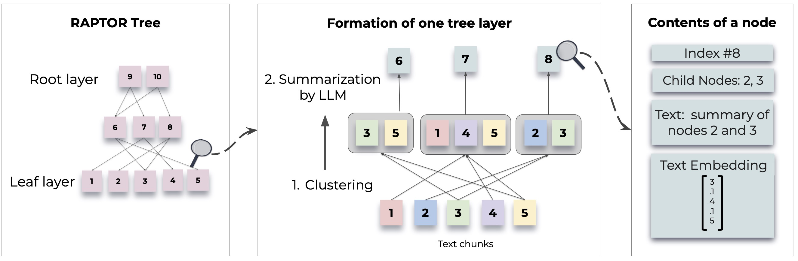

<picture>
  <source media="(prefers-color-scheme: dark)" srcset="docs/images/raptor_dark.png">
  
</picture>

# Raptor-code

**Tree-organized retrieval for long documents (and, soon, codebases).**

RAPTOR builds a tree over a document: it splits the text into chunks, clusters similar
chunks, summarizes each cluster, and repeats on the summaries. A question can then be
answered from both the fine-grained chunks and the higher-level summaries, which helps
with questions that span a whole document.

This repository is a production-oriented rework of the original RAPTOR implementation,
with Gemini and local models, a safe index format, tests, and a CLI. It is the base for
a strategy-experiment harness, codebase indexing, and a web UI (see the [roadmap](#roadmap)).

## Install

Python 3.10+.

```bash
python -m venv .venv
```
```bash
.venv/Scripts/activate          # Windows; on macOS/Linux: source .venv/bin/activate
```
```bash
pip install -e ".[gemini,app,dev]"
```

Optional extras: `local` (sentence-transformers embeddings and a cross-encoder reranker,
runs offline), `ollama` (local LLMs through Ollama), `all`.

Put your Gemini key in a `.env` file (gitignored):

```bash
cp .env.example .env    # then set GEMINI_API_KEY=...
```

Extra keys (`GEMINI_API_KEY2`, `GEMINI_API_KEY3`, ...) are used round-robin, with
failover when a key is rate-limited. Quotas are per Google Cloud project, so extra keys
only add capacity if they come from different projects.

## Quickstart

```python
from raptor import RaptorConfig, RetrievalAugmentation

config = RaptorConfig()
config.chunking.max_tokens = 150

ra = RetrievalAugmentation(config)  # Gemini models with an on-disk cache
ra.add_documents(open("demo/sample.txt", encoding="utf-8").read())
print(ra.answer_question("How did Cinderella reach her happy ending?"))

ra.save("artifacts/indexes/cinderella")  # a directory: tree.json + embeddings.npz
ra = RetrievalAugmentation(config, tree="artifacts/indexes/cinderella")
```

Inspect what was retrieved:

```python
result = ra.retrieve_nodes("Who helped Cinderella?", top_k=8)
for r in result.nodes:
    print(r.layer, r.node.index, round(r.score, 3), r.node.text[:80])
```

### CLI

```bash
raptor build demo/sample.txt --out artifacts/indexes/cinderella
```
```bash
raptor ask artifacts/indexes/cinderella "How did Cinderella reach her happy ending?" --show-context
```
```bash
raptor info demo/trees/quality_story_1_gemini
```
```bash
raptor migrate old_tree.pkl artifacts/indexes/old_tree    # convert a tree saved by the original RAPTOR
```

All settings live in a YAML-serializable `RaptorConfig` (`raptor build -c config.yaml`):

```yaml
chunking:   {strategy: sentence, max_tokens: 150, overlap_tokens: 0}
clustering: {strategy: raptor_gmm, reduction_dimension: 10, threshold: 0.1, random_state: 224}
builder:    {max_layers: 5, summarization_length: 100, max_workers: 4}
retrieval:  {mode: collapsed, top_k: 10, max_tokens: 3500}
models:     {provider: gemini, embedding_model: gemini-embedding-001, llm_model: gemini-3.5-flash-lite}
```

### Your own models

Subclass `BaseEmbeddingModel` (implement `embed_documents` for batches, or the original
`create_embedding`), `BaseSummarizationModel.summarize`, or `BaseQAModel.answer_question`,
and pass the instances in:

```python
ra = RetrievalAugmentation(
    config,
    embedding_model=MyEmbedder(),
    summarization_model=MySummarizer(),
    qa_model=MyQA(),
    cache=True,
)
```

The original `RetrievalAugmentationConfig(tb_max_tokens=..., tr_top_k=..., qa_model=...)`
interface still works.

### QuALITY demo

```bash
python scripts/download_quality.py
```
```bash
python examples/quality_compare.py --story 1
```
```bash
streamlit run app.py
```

`demo/trees/` holds prebuilt trees for the first two QuALITY dev stories and Cinderella.
An earlier 15-question run (`demo/results/quality_eval_results.json`) scored Flat RAG and
RAPTOR the same (53%). That sample is far too small to separate them; the experiment
harness on the roadmap is meant to measure this properly.

## Development

```bash
pytest                 # offline unit tests (fake models, no network)
```
```bash
pytest -m live         # end-to-end against Gemini (needs GEMINI_API_KEY)
```
```bash
ruff check . && ruff format --check . && mypy
```

See [docs/ARCHITECTURE.md](docs/ARCHITECTURE.md) for how the package is organized and
what changed from the original code.

## Roadmap

1. **Production cleanup** (done): package layout, safe storage, batched and cached
   Gemini calls, bug fixes, tests, CI.
2. **Strategy experiments**: an eval harness on QuALITY comparing chunking,
   clustering, summarization, retrieval and embedding strategies.
3. **Codebases**: tree-sitter symbol chunking, a structural plus semantic hierarchy,
   call and import graphs, incremental indexing, a CLI and an MCP server.
4. **Web UI**: a React app on a FastAPI service, with live build progress, a tree
   explorer, a Flat-vs-RAPTOR arena, experiment dashboards and a code explorer.

## Acknowledgements

This project builds on **RAPTOR** by Parth Sarthi, Salman Abdullah, Aditi Tuli, Shubh
Khanna, Anna Goldie and Christopher D. Manning, and on the original implementation at
[parthsarthi03/raptor](https://github.com/parthsarthi03/raptor) (MIT). The QuALITY
benchmark is by Pang et al. ([nyu-mll/quality](https://github.com/nyu-mll/quality)).

```bibtex
@inproceedings{sarthi2024raptor,
    title={RAPTOR: Recursive Abstractive Processing for Tree-Organized Retrieval},
    author={Sarthi, Parth and Abdullah, Salman and Tuli, Aditi and Khanna, Shubh and Goldie, Anna and Manning, Christopher D.},
    booktitle={International Conference on Learning Representations (ICLR)},
    year={2024}
}
```

## License

MIT. See [LICENSE.txt](LICENSE.txt); the original copyright notice is retained.
