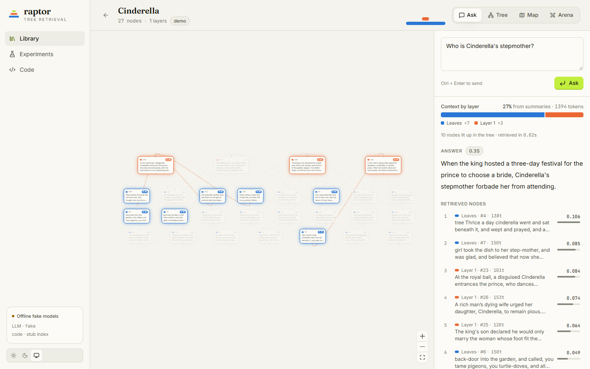
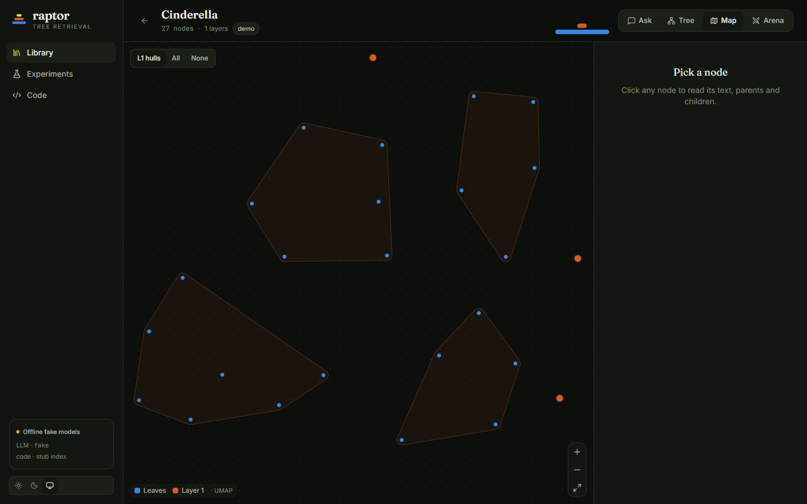
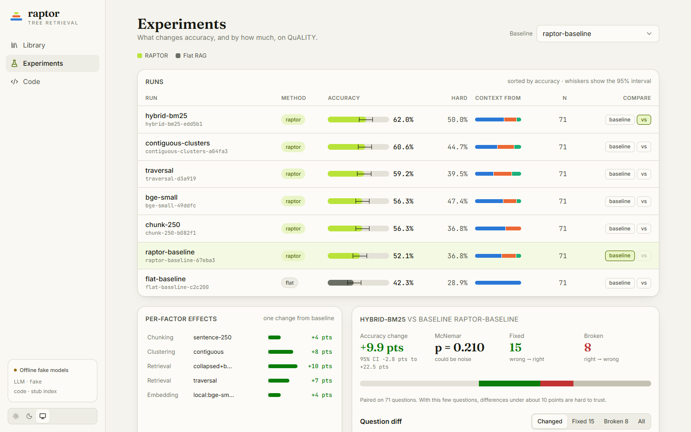
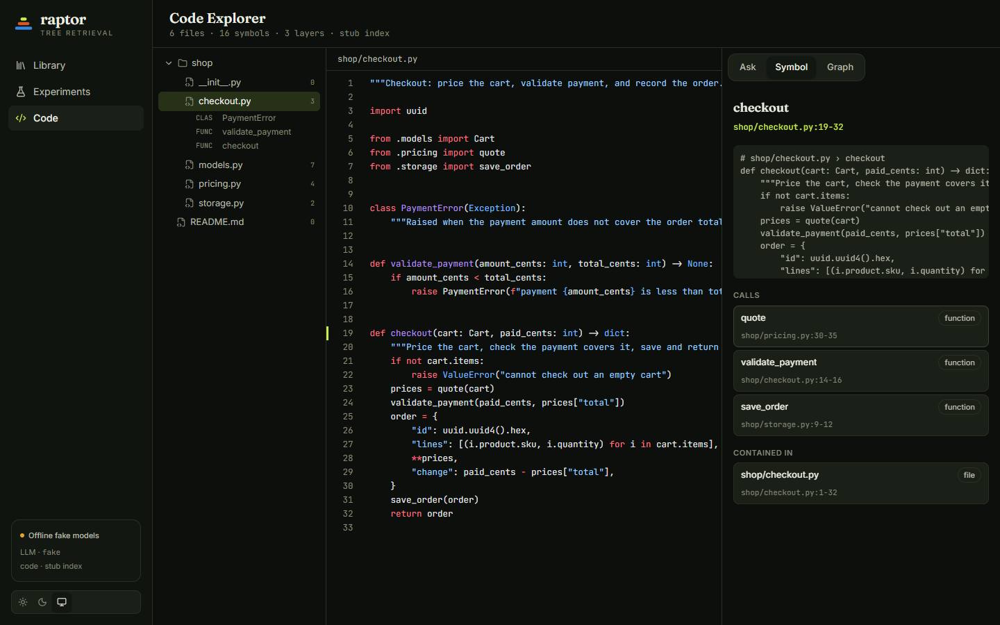
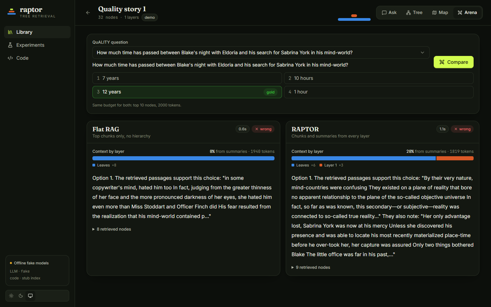
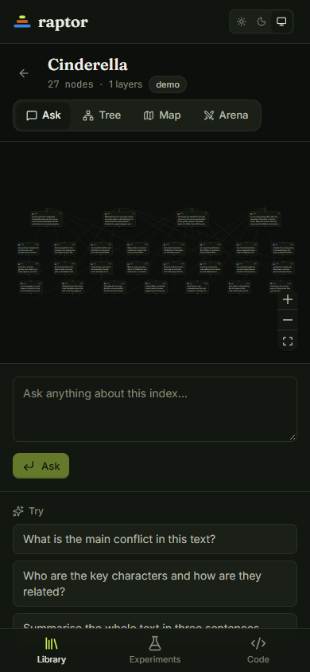

# Web UI

RAPTOR ships a web UI (React) served by a small FastAPI service. One process serves both.



## Run it

```bash
pip install -e ".[gemini,server]"
cd web && npm install && npm run build && cd ..   # once; produces web/dist
raptor serve                                       # http://127.0.0.1:8765
raptor serve --fake-models                         # deterministic offline models, no API key or quota
```

`raptor serve --help` lists `--port`, `--host`, `--fake-delay` (token pacing for fake models), `--dev` and `--web-dist`.
Interactive API docs are at `/docs`.

## What is in it

| Page | What it does |
| --- | --- |
| Library | Index cards with their tree shape. "New index" builds from pasted text, an uploaded file or a QuALITY story, with a strategy preset. |
| Build | Live pipeline over SSE: chunking, embedding, clustering, then each summary as it is written, with token counts. |
| Workspace > Ask | Streams an answer; the retrieved nodes light up in the tree and a bar shows how much context came from each layer. |
| Workspace > Tree / Map | Zoomable layered DAG with a node inspector; a 2-D embedding map with cluster hulls. |
| Workspace > Arena | Flat RAG vs RAPTOR with the same budget. For QuALITY indexes, pick a benchmark question to see the options and gold answer. |
| Experiments | Runs table with accuracy and 95% CI whiskers, one-factor effects, McNemar and the fixed/broken question diff against a chosen baseline. |
| Code Explorer | File tree, symbol panel, call/import graph, and Ask with clickable `path:line` citations that open the viewer on those lines. |






Dark and light themes follow the system setting and can be switched in the sidebar. Layouts work down to phone width.



## Architecture

```
web/            Vite + React + TypeScript, Tailwind, TanStack Query, React Router, React Flow, visx, Shiki
raptor/server/  FastAPI: thin over pipeline / storage / eval / code
```

- The OpenAPI schema is the contract. `npm run gen:api` regenerates `web/src/api/schema.d.ts`; `tsc` then catches drift.
- Long work (builds) runs as background jobs. Progress, retrieval and answer tokens are server-sent events
  (`/api/jobs/{id}/events`, `/api/indexes/{id}/query`, `/compare`, `/api/code/{id}/ask`).
- Experiment runs and code indexes come from the Phase 2 / Phase 3 packages when importable. Otherwise the server falls back
  to run files under `artifacts/runs/` and a stub code index (`/api/info` reports `runs_backend` and `code_backend`).
  The sidebar shows "stub index" when the stub is in use.
- The demo trees under `demo/trees/` were built without embedding task types; the server reads the task types from each tree's recorded embedding model and uses none for these, so queries match how the tree was embedded.

## Dev workflow

```bash
raptor serve --fake-models --dev   # API with reload, CORS for the Vite dev server
cd web && npm run dev              # http://localhost:5173, proxies /api to :8765
```

| Check | Command |
| --- | --- |
| Backend tests, lint, types | `pytest -q`, `ruff check .`, `mypy` |
| Frontend types | `npm run typecheck` (in `web/`) |
| Frontend unit tests | `npm test` |
| End-to-end smoke (build, ask, nodes highlight) | `npx playwright test` (set `PW_CHANNEL=msedge` or `chrome` to use an installed browser) |

The smoke test starts `raptor serve --fake-models` itself and needs `web/dist` to exist.
