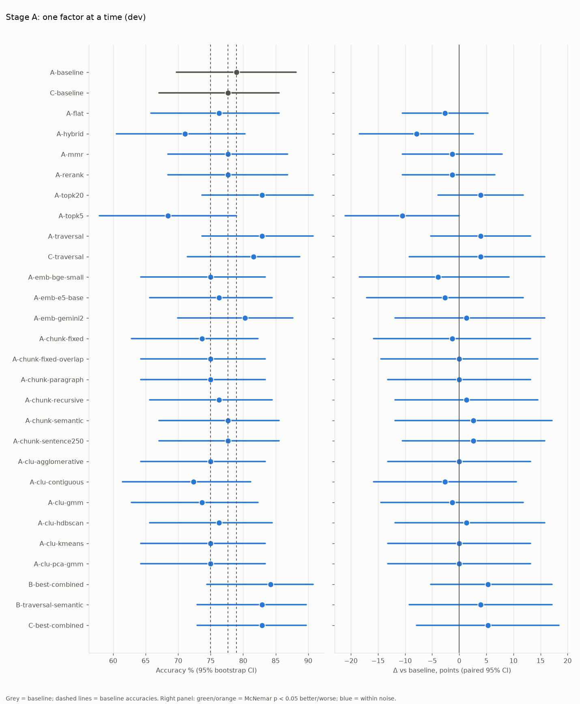
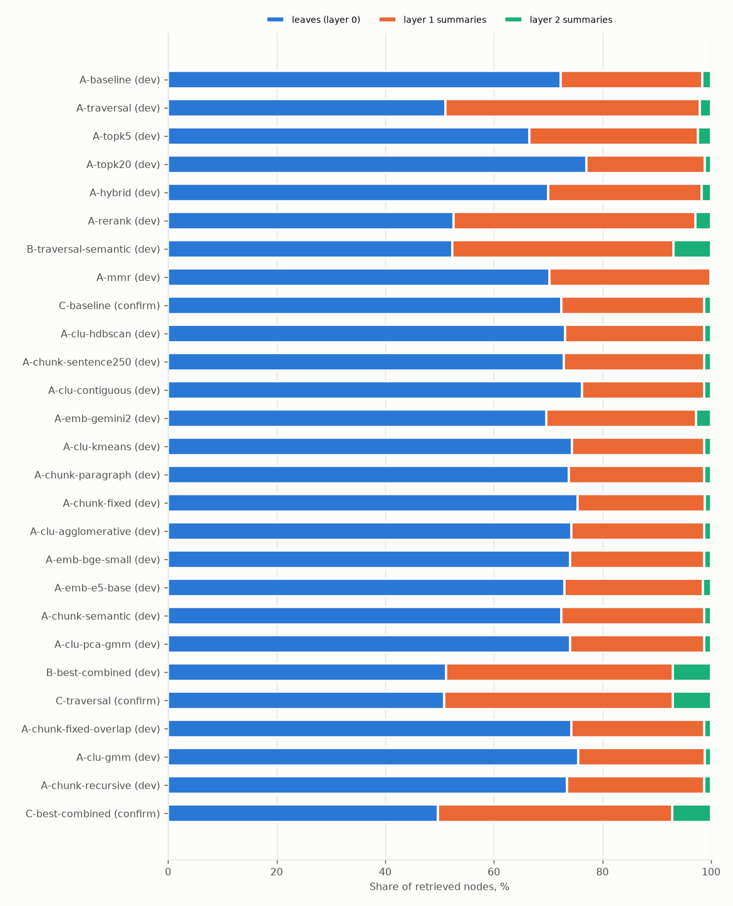

# RAPTOR strategy sweep on QuALITY

_Generated 2026-11-11 16:33 UTC by `raptor eval report` from 28 runs in `artifacts/runs`. Do not edit by hand: conclusions live in `conclusions.md`._

## Setup

- Splits (`configs/splits.yaml`): `confirm` = 76 questions over 8 stories, `dev` = 76 questions over 8 stories. Dev and confirm use disjoint articles.
- Reader (fixed): `gemini-3.5-flash-lite` with JSON-mode MCQ answers.
- Accuracy CIs: percentile bootstrap (10k resamples). Δ CIs: paired bootstrap over questions. p-values: exact two-sided McNemar test on the discordant pairs vs the run's baseline.
- **Noise floor:** with ~70 questions a 95% CI on accuracy is about ±11 points, so only large, consistent differences mean anything. "Within noise" below means McNemar p ≥ 0.05.
- "Summary-node share" is the fraction of retrieved nodes that are summaries (layer ≥ 1) rather than leaf chunks. LLM calls count summaries + answers that were not already cached when the run happened.

## Stage A: one factor at a time (dev)

| Run | Varies | Setting | vs | Acc % | 95% CI | Hard acc % | Δ vs base (pts) [95% CI] | McNemar p | fixed / broken | Summary-node share % | LLM calls | Build s/story | Nodes/tree | Verdict |
|---|---|---|---|---:|---|---:|---|---:|---|---:|---:|---:|---:|---|
| `A-baseline` | baseline | sentence-100 / raptor_gmm / collapsed-k10 / gemini-embedding-001 | - | 78.9 | 69.7–88.2 | 71.0 | - | - | - | 28 | 94 | 55 | 69 | baseline |
| `C-baseline` | baseline | sentence-100 / raptor_gmm / collapsed-k10 / gemini-embedding-001 | - | 77.6 | 67.1–85.5 | 73.3 | - | - | - | 28 | 94 | 56 | 69 | baseline |
| `A-flat` | method | flat | `A-baseline` | 76.3 | 65.8–85.5 | 74.2 | -2.6 [-10.5, +5.3] | 0.754 | 4 / 6 | 0 | 73 | 0 | 59 | within noise |
| `A-hybrid` | retrieval | collapsed-k10+bm25 | `A-baseline` | 71.1 | 60.5–80.3 | 54.8 | -7.9 [-18.4, +2.6] | 0.210 | 5 / 11 | 30 | 75 | 56 | 69 | within noise |
| `A-mmr` | retrieval | collapsed-k10+mmr0.5 | `A-baseline` | 77.6 | 68.4–86.8 | 71.0 | -1.3 [-10.5, +7.9] | 1.000 | 5 / 6 | 30 | 76 | 56 | 69 | within noise |
| `A-rerank` | retrieval | collapsed-k10+rerank | `A-baseline` | 77.6 | 68.4–86.8 | 71.0 | -1.3 [-10.5, +6.6] | 1.000 | 5 / 6 | 47 | 76 | 56 | 69 | within noise |
| `A-topk20` | retrieval | collapsed-k20 | `A-baseline` | 82.9 | 73.7–90.8 | 74.2 | +3.9 [-3.9, +11.8] | 0.508 | 6 / 3 | 23 | 76 | 56 | 69 | within noise |
| `A-topk5` | retrieval | collapsed-k5 | `A-baseline` | 68.4 | 57.9–78.9 | 58.1 | -10.5 [-21.1, +0.0] | 0.077 | 4 / 12 | 33 | 76 | 56 | 69 | within noise |
| `A-traversal` | retrieval | traversal-k10 | `A-baseline` | 82.9 | 73.7–90.8 | 71.0 | +3.9 [-5.3, +13.2] | 0.581 | 8 / 5 | 49 | 76 | 56 | 69 | within noise |
| `C-traversal` | retrieval | traversal-k10 | `C-baseline` | 81.6 | 71.4–88.7 | 76.7 | +3.9 [-9.2, +15.8] | 0.678 | 13 / 10 | 49 | 94 | 57 | 69 | within noise |
| `A-emb-bge-small` | embedding | bge-small-en-v1.5 | `A-baseline` | 75.0 | 64.2–83.4 | 67.7 | -3.9 [-18.4, +9.2] | 0.711 | 13 / 16 | 26 | 78 | 48 | 65 | within noise |
| `A-emb-e5-base` | embedding | e5-base-v2 | `A-baseline` | 76.3 | 65.6–84.5 | 71.0 | -2.6 [-17.1, +11.8] | 0.856 | 14 / 16 | 27 | 78 | 53 | 66 | within noise |
| `A-emb-gemini2` | embedding | gemini-embedding-2 | `A-baseline` | 80.3 | 70.0–87.7 | 74.2 | +1.3 [-11.8, +15.8] | 1.000 | 15 / 14 | 30 | 94 | 78 | 70 | within noise |
| `A-chunk-fixed` | chunking | fixed-100 | `A-emb-bge-small` | 73.7 | 62.8–82.3 | 67.7 | -1.3 [-15.8, +13.2] | 1.000 | 15 / 16 | 25 | 78 | 45 | 64 | within noise |
| `A-chunk-fixed-overlap` | chunking | fixed-100-ov20 | `A-emb-bge-small` | 75.0 | 64.2–83.4 | 71.0 | +0.0 [-14.5, +14.5] | 1.000 | 15 / 15 | 26 | 78 | 46 | 68 | within noise |
| `A-chunk-paragraph` | chunking | paragraph-100 | `A-emb-bge-small` | 75.0 | 64.2–83.4 | 67.7 | +0.0 [-13.2, +13.2] | 1.000 | 13 / 13 | 26 | 78 | 46 | 63 | within noise |
| `A-chunk-recursive` | chunking | recursive-100 | `A-emb-bge-small` | 76.3 | 65.6–84.5 | 71.0 | +1.3 [-11.8, +14.5] | 1.000 | 13 / 12 | 26 | 78 | 47 | 66 | within noise |
| `A-chunk-semantic` | chunking | semantic-100 | `A-emb-bge-small` | 77.6 | 67.1–85.5 | 74.2 | +2.6 [-11.8, +17.1] | 0.864 | 18 / 16 | 28 | 78 | 51 | 68 | within noise |
| `A-chunk-sentence250` | chunking | sentence-250 | `A-emb-bge-small` | 77.6 | 67.1–85.5 | 71.0 | +2.6 [-10.5, +15.8] | 0.845 | 14 / 12 | 27 | 78 | 48 | 61 | within noise |
| `A-clu-agglomerative` | clustering | agglomerative | `A-emb-bge-small` | 75.0 | 64.2–83.4 | 67.7 | +0.0 [-13.2, +13.2] | 1.000 | 14 / 14 | 26 | 78 | 44 | 64 | within noise |
| `A-clu-contiguous` | clustering | contiguous | `A-emb-bge-small` | 72.4 | 61.4–81.2 | 64.5 | -2.6 [-15.8, +10.5] | 0.851 | 13 / 15 | 24 | 78 | 42 | 62 | within noise |
| `A-clu-gmm` | clustering | gmm | `A-emb-bge-small` | 73.7 | 62.8–82.3 | 67.7 | -1.3 [-14.5, +11.8] | 1.000 | 12 / 13 | 24 | 78 | 43 | 64 | within noise |
| `A-clu-hdbscan` | clustering | hdbscan | `A-emb-bge-small` | 76.3 | 65.6–84.5 | 71.0 | +1.3 [-11.8, +15.8] | 1.000 | 15 / 14 | 27 | 78 | 50 | 65 | within noise |
| `A-clu-kmeans` | clustering | kmeans_silhouette | `A-emb-bge-small` | 75.0 | 64.2–83.4 | 67.7 | +0.0 [-13.2, +13.2] | 1.000 | 14 / 14 | 26 | 78 | 45 | 65 | within noise |
| `A-clu-pca-gmm` | clustering | pca_gmm | `A-emb-bge-small` | 75.0 | 64.2–83.4 | 71.0 | +0.0 [-13.2, +13.2] | 1.000 | 13 / 13 | 26 | 78 | 45 | 65 | within noise |
| `B-best-combined` | combined | sentence-100 / raptor_gmm / traversal-k20 / gemini-embedding-2 | `A-baseline` | 84.2 | 74.4–90.7 | 77.4 | +5.3 [-5.3, +17.1] | 0.503 | 12 / 8 | 49 | 94 | 80 | 70 | within noise |
| `B-traversal-semantic` | combined | semantic-100 / raptor_gmm / traversal-k10 / gemini-embedding-001 | `A-baseline` | 82.9 | 72.9–89.7 | 74.2 | +3.9 [-9.2, +17.1] | 0.690 | 14 / 11 | 48 | 94 | 68 | 69 | within noise |
| `C-best-combined` | combined | sentence-100 / raptor_gmm / traversal-k20 / gemini-embedding-2 | `C-baseline` | 82.9 | 72.9–89.7 | 80.0 | +5.3 [-7.9, +18.4] | 0.541 | 14 / 10 | 50 | 94 | 82 | 71 | within noise |

Significant vs baseline: none. Within noise: 26 of 26 comparisons.

## Where retrieved context comes from

## Cost

Across all runs: 2278 LLM calls, 2670 embedded texts (local + API), 5403 cache hits, 8144 misses. Retrieval-only variants reuse cached trees and cost one reader call per question; re-running a finished config costs nothing.

## Runs

| Run id | Split | Method | Chunking | Clustering | Retrieval | Embedding |
|---|---|---|---|---|---|---|

| `a-baseline-af0f5a22` | dev | raptor | sentence-100 | raptor_gmm | collapsed-k10 | gemini-embedding-001 |

| `a-flat-837def13` | dev | flat | sentence-100 | none | flat-k10 | gemini-embedding-001 |

| `a-traversal-b7b313f5` | dev | raptor | sentence-100 | raptor_gmm | traversal-k10 | gemini-embedding-001 |

| `a-topk5-37c7ea1b` | dev | raptor | sentence-100 | raptor_gmm | collapsed-k5 | gemini-embedding-001 |

| `a-topk20-5d727ff2` | dev | raptor | sentence-100 | raptor_gmm | collapsed-k20 | gemini-embedding-001 |

| `a-hybrid-b08aedf8` | dev | raptor | sentence-100 | raptor_gmm | collapsed-k10+bm25 | gemini-embedding-001 |

| `a-rerank-7bf80b41` | dev | raptor | sentence-100 | raptor_gmm | collapsed-k10+rerank | gemini-embedding-001 |

| `b-traversal-semantic-fb8be1da` | dev | raptor | semantic-100 | raptor_gmm | traversal-k10 | gemini-embedding-001 |

| `a-mmr-1ad5299d` | dev | raptor | sentence-100 | raptor_gmm | collapsed-k10+mmr0.5 | gemini-embedding-001 |

| `c-baseline-86d02fe3` | confirm | raptor | sentence-100 | raptor_gmm | collapsed-k10 | gemini-embedding-001 |

| `a-clu-hdbscan-02a17b44` | dev | raptor | sentence-100 | hdbscan | collapsed-k10 | bge-small-en-v1.5 |

| `a-chunk-sentence250-d0eea4aa` | dev | raptor | sentence-250 | raptor_gmm | collapsed-k10 | bge-small-en-v1.5 |

| `a-clu-contiguous-91662d52` | dev | raptor | sentence-100 | contiguous | collapsed-k10 | bge-small-en-v1.5 |

| `a-emb-gemini2-29dbc7f5` | dev | raptor | sentence-100 | raptor_gmm | collapsed-k10 | gemini-embedding-2 |

| `a-clu-kmeans-7a1de4ab` | dev | raptor | sentence-100 | kmeans_silhouette | collapsed-k10 | bge-small-en-v1.5 |

| `a-chunk-paragraph-51647fc8` | dev | raptor | paragraph-100 | raptor_gmm | collapsed-k10 | bge-small-en-v1.5 |

| `a-chunk-fixed-65e51fc2` | dev | raptor | fixed-100 | raptor_gmm | collapsed-k10 | bge-small-en-v1.5 |

| `a-clu-agglomerative-3f4c463a` | dev | raptor | sentence-100 | agglomerative | collapsed-k10 | bge-small-en-v1.5 |

| `a-emb-bge-small-398cddec` | dev | raptor | sentence-100 | raptor_gmm | collapsed-k10 | bge-small-en-v1.5 |

| `a-emb-e5-base-ea4f3ffa` | dev | raptor | sentence-100 | raptor_gmm | collapsed-k10 | e5-base-v2 |

| `a-chunk-semantic-a371dadd` | dev | raptor | semantic-100 | raptor_gmm | collapsed-k10 | bge-small-en-v1.5 |

| `a-clu-pca-gmm-58b816f6` | dev | raptor | sentence-100 | pca_gmm | collapsed-k10 | bge-small-en-v1.5 |

| `b-best-combined-12f15972` | dev | raptor | sentence-100 | raptor_gmm | traversal-k20 | gemini-embedding-2 |

| `c-traversal-13c1fbf7` | confirm | raptor | sentence-100 | raptor_gmm | traversal-k10 | gemini-embedding-001 |

| `a-chunk-fixed-overlap-5116e385` | dev | raptor | fixed-100-ov20 | raptor_gmm | collapsed-k10 | bge-small-en-v1.5 |

| `a-clu-gmm-d03c4f14` | dev | raptor | sentence-100 | gmm | collapsed-k10 | bge-small-en-v1.5 |

| `a-chunk-recursive-e6e49e19` | dev | raptor | recursive-100 | raptor_gmm | collapsed-k10 | bge-small-en-v1.5 |

| `c-best-combined-f6d8a54c` | confirm | raptor | sentence-100 | raptor_gmm | traversal-k20 | gemini-embedding-2 |
